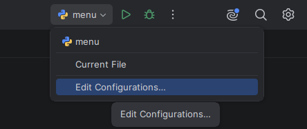
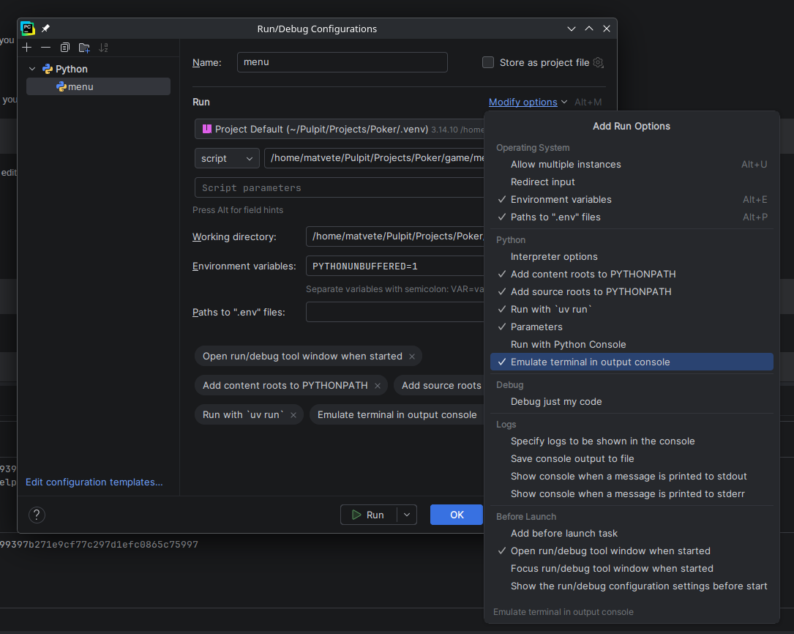

# Lan Vegas

Lan Vegas python package that lets you play games with your friends on lan! It is a learning project in which we build to develop our programing skills and team work.

### Setup

first you need to have uv installed on your pc then simply run
```bash
uv sync
```
and that's it, u are good to go

### Commands
to see all just commands run

```bash
just
```

to check for formating run
```bash
just check
```
to fix mistakes and formating run
```bash
just fix
```

## Testing
To test the project you need to run it in the terminal
```aiignore
python3 main.py
```

#### If you're using pycharm, you need to edit your running configuration to emulate the Terminal.




